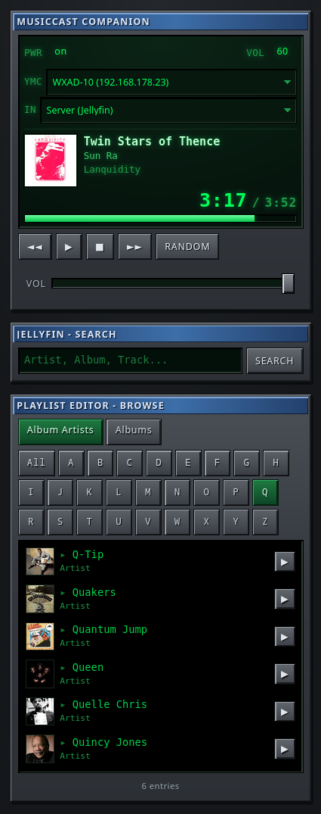

# MusicCast Companion

**Modern web app for controlling Yamaha MusicCast devices with Jellyfin music library**

MusicCast Companion is a **LAN-based web application** that acts as a proxy between your **Yamaha MusicCast device** (receiver, soundbar, speaker) and **Jellyfin**. It provides a **mobile-optimized interface** for controlling playback, browsing your music library, and managing multiple MusicCast devices.

<p align="center">
  
</p>

---

## 🎯 Features

| Feature | Description |
|---------|-------------|
| **Multiple Devices** | Automatic detection of all MusicCast devices on the network via UPnP |
| **Device Selection** | Easy switching between different Yamaha devices via dropdown |
| **Jellyfin Integration** | Full access to your music library (albums, artists, tracks, search) |
| **Playback Control** | Play, Stop, Pause, Previous/Next, Volume, Random Play |
| **Input Selection** | Switch between different inputs (HDMI, USB, Radio, etc.) |
| **Album Art** | Display album covers from Jellyfin |
| **Progress Bar** | Visual playback time display with seek functionality |
| **Mobile Optimization** | Touch-friendly interface for smartphones and tablets |
| **Consistent Design** | Modern, uniform UI with consistent button sizes |

---

## 📋 Requirements

| Component | Requirement |
|-----------|-------------|
| **Binary** | Prebuilt static binary from [GitHub releases](https://github.com/4kind/musiccast-companion/releases) (`linux/amd64` or `linux/arm64`) — no runtime dependencies, no Go needed on the server |
| **Go** | 1.22+ only if building from source |
| **Jellyfin** | Installed and reachable on the local network |
| **Yamaha MusicCast** | At least one device on the network (receiver, soundbar, etc.) |
| **Network** | Server/NAS must be able to reach Jellyfin and Yamaha devices via HTTP |
| **Port** | 8765/tcp (default, configurable via `PORT`) |

**Important:** The Jellyfin URL **must be reachable from the Yamaha device** (do not use `localhost` or `127.0.0.1`)!

---

## 🚀 Installation

### 1. Download the binary

Download the matching binary for the server/NAS architecture from the
[GitHub releases](https://github.com/4kind/musiccast-companion/releases):

```bash
# Check architecture first: x86_64 -> amd64, aarch64 -> arm64
uname -m

# Example for arm64 (adjust architecture and version):
cd /tmp
curl -LO https://github.com/4kind/musiccast-companion/releases/download/v0.1.1/musiccast-companion-linux-arm64
chmod +x musiccast-companion-linux-arm64
```

Alternatively via `gh`:

```bash
gh release download v0.1.1 --pattern 'musiccast-companion-linux-*' --dir /tmp
```

### 2. Copy binary and static files to the server

Only the binary and `static/` are needed at runtime (the app reads `static/`
from disk relative to its working directory). With `scp`:

```bash
scp /tmp/musiccast-companion-linux-* <nas-host>:/tmp/
scp -r static <nas-host>:/tmp/
```

Or use the deploy script from a clone of this repo (it detects the NAS
architecture and copies everything):

```bash
./deploy-to-nas.sh <nas-host> /tmp/musiccast-companion-linux-arm64
```

### 3. Install

On the server:

```bash
sudo install -d /opt/musiccast-companion
sudo install -m 755 /tmp/musiccast-companion-linux-* /opt/musiccast-companion/musiccast-companion
sudo cp -r /tmp/static /opt/musiccast-companion/
sudo chown -R jellyfin:jellyfin /opt/musiccast-companion
```

### Building from source (alternative to step 1)

If no release binary fits, build it yourself (static, cross-compiled):

```bash
# On the dev machine; GOARCH must match the server (amd64 or arm64)
CGO_ENABLED=0 GOOS=linux GOARCH=arm64 go build -trimpath -o musiccast-companion-linux-arm64 .
```

Go is **not** required on the server/NAS for installation — only for building
from source.

### 4. Set up systemd service

Create `/etc/systemd/system/musiccast-companion.service`:

```ini
[Unit]
Description=MusicCast Companion (Yamaha MusicCast + Jellyfin)
After=network-online.target
Wants=network-online.target

[Service]
Type=simple
User=jellyfin
Group=jellyfin
WorkingDirectory=/opt/musiccast-companion
ExecStart=/opt/musiccast-companion/musiccast-companion

# Jellyfin configuration (required)
Environment=JELLYFIN_URL=http://YOUR_JELLYFIN_IP:8096
Environment=JELLYFIN_API_KEY=your-api-key-here

# Yamaha configuration (optional - automatically discovered via UPnP)
# Environment=YAMAHA_IP=192.168.1.X

# Port configuration (optional, default: 8765)
# Environment=PORT=8765

Restart=always
RestartSec=2

# Security
NoNewPrivileges=true
ProtectSystem=strict
ProtectHome=true
PrivateTmp=true

[Install]
WantedBy=multi-user.target
```

**Important:**
- `JELLYFIN_URL` **must be reachable from the Yamaha device** (no `localhost`!)
- `YAMAHA_IP` is **optional** - without it, the app will automatically search for devices
- If `YAMAHA_IP` is set, that device will be automatically selected at startup

Enable the service:

```bash
sudo systemctl daemon-reload
sudo systemctl enable --now musiccast-companion
```

### 5. Verify

```bash
systemctl status musiccast-companion
journalctl -u musiccast-companion -n 20 --no-pager
```

The app should start and display found devices in the logs:

```
🚀 Go backend running on http://localhost:8765
   LAN accessible at http://<server-ip>:8765/
   Yamaha (discovered via UPnP) · Jellyfin http://<jellyfin-ip>:8096 · API-Key ...xxxx
   UPnP Discovery: 2 MusicCast devices found:
     - Living Room (RX-V685) at 192.168.1.23
     - Kitchen (WX-010) at 192.168.1.27
```

---

## 🔧 Configuration

### Environment Variables

| Variable | Required | Description | Example |
|----------|----------|-------------|---------|
| `JELLYFIN_URL` | ✅ Yes | Base URL of Jellyfin server | `http://<jellyfin-ip>:8096` |
| `JELLYFIN_API_KEY` | ✅ Yes | API key for Jellyfin | `your-api-key-here` |
| `YAMAHA_IP` | ❌ No | Default device IP (optional) | `192.168.1.X` |
| `PORT` | ❌ No | Web server port | `8765` |

### Generate Jellyfin API Key

1. Jellyfin Dashboard → **API Keys** → **+**
2. Enter a name (e.g., `musiccast`)
3. Copy the key and use it for `JELLYFIN_API_KEY`

**Note:** The key belongs to the user who creates it. Only their music libraries will be visible.

### Configuration in Separate File

If the unit file is readable by everyone:

```bash
sudo install -m 600 /dev/null /etc/musiccast-companion.env
sudo tee /etc/musiccast-companion.env >/dev/null <<'EOF'
JELLYFIN_URL=http://YOUR_JELLYFIN_IP:8096
JELLYFIN_API_KEY=your-api-key-here
YAMAHA_IP=192.168.1.X
EOF
```

In the unit:
```ini
EnvironmentFile=/etc/musiccast-companion.env
```

---

## 🎛️ Device Selection

MusicCast Companion supports **automatic device discovery**:

1. **At startup**, the app scans the network for MusicCast devices
2. **In the UI**, a dropdown (**YMC**) shows all found devices
3. **When switching**, the new device is used immediately - **no restart needed!**

### Devices not found?

- **Device is turned off** → Turn it on
- **UPnP disabled** → Check Yamaha device network settings
- **Different network** → Device must be on the same subnet
- **Debugging:** Check logs with `journalctl -u musiccast-companion -f`

---

## 📊 UI Overview

### Main Window
- **PWR**: Power on/off status
- **VOL**: Volume with slider
- **YMC**: Device selection dropdown (Yamaha MusicCast)
- **IN**: Input selection dropdown
- **Transport**: Previous, Play, Stop, Next track
- **RANDOM**: Random playback from current library

### Search Panel
- **Search**: Text search for artists, albums, tracks
- **Filter**: All / Albums / Artists / Tracks

### Queue
- Current Jellyfin context: album track list with position (or random mode with history)
- Click a track to play it; current track highlighted

### Playlist Editor (Browse)
- **Libraries**: Filter by music library
- **Categories**: Album Artists / Albums / Favorites (Jellyfin favorites)
- **Sorting**: A-Z / Newest
- **A-Z Jump**: Quick navigation

### Keyboard shortcuts
- **Space**: Play/Stop toggle · **ArrowLeft/Right**: Previous/Next track · **ArrowUp/Down**: Volume ±1

---

## 🔄 Updating

### Using Deploy Script

```bash
./deploy-to-nas.sh <nas-host> [path-to-binary]
```

The script:
- Uses the given binary (e.g. from a GitHub release) or cross-compiles locally
  for the NAS architecture (static binary, `CGO_ENABLED=0`, arch detected via ssh)
- Copies binary + `static/` to the NAS
- Installs to `/opt/musiccast-companion`
- Restarts the service
- **Asks for sudo password only once**

The release binaries (`musiccast-companion-linux-amd64` / `-arm64`) from GitHub
releases can be deployed directly:

```bash
./deploy-to-nas.sh <nas-host> musiccast-companion-linux-arm64
```

### Manual Update

Download the new release binary (or build it, see Installation), then:

```bash
# On the dev machine: download matching binary, e.g.
gh release download v0.1.1 --pattern 'musiccast-companion-linux-*' --dir /tmp
scp /tmp/musiccast-companion-linux-* <nas-host>:/tmp/

# On the NAS
sudo install -m 755 /tmp/musiccast-companion-linux-* /opt/musiccast-companion/musiccast-companion
sudo cp -r static /opt/musiccast-companion/   # only if static/ changed
sudo systemctl restart musiccast-companion
```

**Note:**
- Changes in `static/` (HTML, CSS, JS) **do not require a restart** - browser refresh is enough
- Backend changes (Go code) **require a restart**

---

## 🛡️ Security

**Important:** The app has **no authentication**!

- Anyone who can reach the port can **control all MusicCast devices** and **play Jellyfin**
- **Only use in local network!**
- **Do not expose to the internet!**
- No port forwarding without additional authentication

---

## 🐛 Troubleshooting

| Symptom | Cause / Solution |
|---------|------------------|
| App won't start, "Missing configuration" | `JELLYFIN_URL` or `JELLYFIN_API_KEY` is missing |
| No devices in YMC dropdown | UPnP discovery failed - check logs |
| Playback won't start, no sound | `JELLYFIN_URL` not reachable from receiver |
| Empty page, 404 | `WorkingDirectory` wrong or `static/` missing |
| 502 on `/api/status` | `YAMAHA_IP` wrong or device not reachable |
| Search/browse empty | `JELLYFIN_URL` or `JELLYFIN_API_KEY` wrong |
| No album art | Jellyfin not providing cover or file has no embedded image |
| Track keeps rewinding | Audio codec not supported - enable Jellyfin transcoding |
| Service won't start | `journalctl -u musiccast-companion -n 30` |

### Test Commands

```bash
# Test Jellyfin API
curl -H 'Authorization: MediaBrowser Token="<api-key>"' http://<jellyfin-ip>:8096/Users

# Test Yamaha device
curl http://<yamaha-ip>/YamahaExtendedControl/v1/system/getDeviceInfo

# Test UPnP discovery
curl http://<yamaha-ip>:49154/MediaRenderer/desc.xml
```

---

## 📚 Technical Details

### Architecture

- **Backend**: Go (HTTP server, proxy to Yamaha/Jellyfin)
- **Frontend**: HTML5 + CSS + JavaScript (no framework, no external dependencies)
- **Communication**: REST API between frontend and backend
- **Protocols**: HTTP/JSON for Jellyfin, UPnP/SOAP for Yamaha

### File Structure

```
.
├── main.go          # Main program, routing, configuration
├── yamaha.go        # Yamaha MusicCast API
├── jellyfin.go      # Jellyfin API, playlist logic
├── upnp.go          # UPnP AVTransport for playback
├── go.mod           # Go module definition
└── static/          # Frontend (HTML, CSS, JS)
    ├── index.html   # HTML structure
    ├── style.css    # Styles
    └── app.js       # JavaScript logic
```

### Network Ports

| Component | Port | Protocol | Direction |
|-----------|------|-----------|----------|
| Web UI | 8765 (default) | HTTP | Browser → NAS |
| Yamaha | 80 | HTTP | NAS → Receiver |
| Yamaha UPnP | 49154 | HTTP/SOAP | NAS → Receiver |
| Jellyfin | 8096 (default) | HTTP | NAS → Jellyfin |

---

## 🤝 Contributing

Found a bug or have improvement suggestions?
- Issues and pull requests are welcome!
- The app is designed for **private use**

---

**Enjoy your MusicCast Companion!** 🎵
